# Typha CRM

**把客户沟通，变成有依据的下一步行动。**

[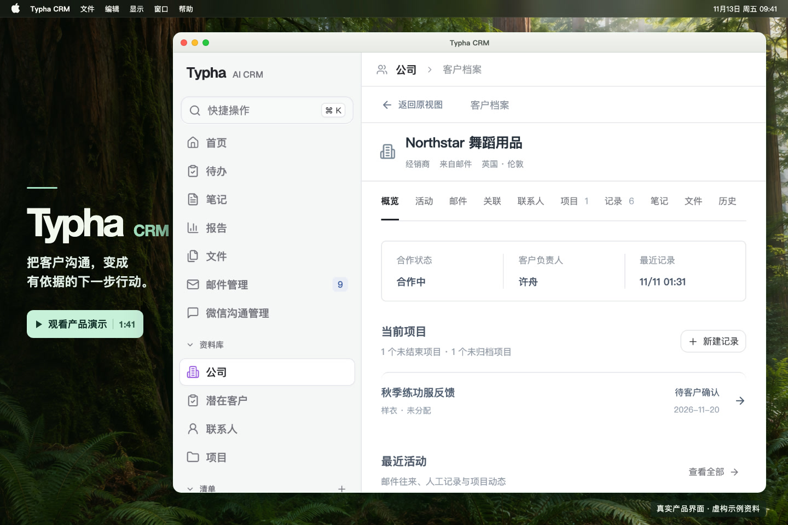][product-demo-video]

[观看产品演示（1:41）][product-demo-video] · [在线体验](https://tomanojerry-debug.github.io/typha-crm/) · [使用场景](#主要使用场景) · [产品介绍](https://tomanojerry-debug.github.io/typha-crm/about.html) · [本机部署](docs/getting-started.md) · [技术架构](docs/architecture.md)

Typha 是面向小型电商品牌与客户沟通团队的 AI CRM。它将已关联的邮件、文档和业务笔记组织到公司、联系人和项目下，帮助你跟进咨询、准备回复，并把客户反馈留给后续产品改进。

引用业务信息时可以打开原文核对；跨轮任务保留有效条件；需要确认的资料修改和邮件发送，由用户按业务流程决定。

> 软件免费，当前支持企业本机部署，模型 API 费用由企业自行承担。后续计划支持部署在企业自行租用的云服务器上。当前为开发预览版本，界面以中文为主；AI 处理会将选定的任务上下文发送至模型服务。

[product-demo-video]: https://github.com/tomanojerry-debug/typha-crm/releases/tag/demo-2026-11-13

## 为什么做 Typha

项目从小型服装、芭蕾舞服品牌的实际工作场景出发：品牌自己设计研发，国内有个人零售、门店和团体定制，海外有经销商与电商业务。内部跟进人手有限，部分平台接待由外包客服承担，客户背景和交接信息容易分散在不同渠道。

同一款产品，可能同时收到个人消费者的尺码咨询、团体客户的定制要求，以及经销商的样衣或售后意见。准备回复时要找回上次谈过的条件，交接时要知道谁在等什么，研发时又需要看清哪些反馈反复出现、来自哪些客户。

Typha 把这些工作放到同一个客户和项目上下文里：保留有来源的客户认知，持续跟进每笔咨询，让已记录的产品反馈能够汇总、筛选并回看原话。

## 主要使用场景

这些流程共用客户、联系人、项目、活动、待办和报告。款式、版本、尺码等业务字段可以按品牌现有的记录方式配置。

### 接到团体定制询盘

1. 在首页点「录入潜在客户」，选择客户和已归档资料，也可以从已关联客户的来信或微信会话开始。核对 AI 整理的条件，再确认新建或关联咨询。首次接触的客户可到「资料库 → 潜在客户 → 新建记录」建立档案和咨询。
2. 到「资料库 → 潜在客户」查看这笔咨询，记录已确认的数量、尺码和交期，以及还缺什么、在等谁、由谁跟进。
3. 被指派的未完成事项会出现在负责人的「待办」。条件确认后更新同一笔咨询，接手的人就能看到进展。

### 回复经销商的样衣来信

1. 在「邮件管理 → 邮箱设置」连接网易个人邮箱。从首页点「处理客户来信」，选择客户、联系人、这封来信及允许参考的历史资料。
2. 选择已有邮件模板或明确不使用模板，补充样衣交期、寄送安排等答复口径。打开生成的草稿，对照引用原文核对并修改。
3. 确认具体版本、收件人、发件账号、附件和时间后，立即发送或安排定时发送。

### 把售后事项交给同事

1. 打开客户的活动，添加交接备注，填写还要查什么，选负责人和截止日期，再点「保存备注并创建待办」。
2. 同事在「待办 → 活动待办」打开原活动、客户背景和原文，开始处理，并在完成时填写实际结果。

### 汇总售后反馈给研发

1. 在「设置 → 活动与 Schema」配置反馈活动类型和字段，例如款式、版本、尺码和问题分类。
2. 在选定的来信或已归档微信会话里生成活动，使用该反馈类型整理客户原话，例如某款练功服的肩带偏长。
3. 在「报告」找到「售后反馈与产品改进」模板，点「选择活动与字段」，指定款式、问题等维度对应的活动字段并保存看板。按款式和问题筛选，查看去重反馈数、涉及客户数与原话，或导出当前页 CSV。

统计基于已记录的反馈活动。字段缺失和需要核实的反馈会单列，方便团队判断哪些问题值得跟进。

## 支持的信息来源

| 来源              | 接入方式与当前支持范围                                                                                     |
| ----------------- | ---------------------------------------------------------------------------------------------------------- |
| 邮件              | 在「邮件管理 → 邮箱设置」连接网易个人邮箱（163、126、Yeah），同步来信及可读取的历史邮件。                  |
| 微信              | 实验性本机读取，需配置本机微信客户端。选择联系人和日期范围，确认客户归属后归档。Windows 尚未完成实机验收。 |
| 文档              | 上传含可提取文字的 PDF 或 DOCX，保留原件和提取的正文。                                                     |
| 笔记              | 在客户档案保存业务笔记，可写下内部沟通要点，也可引用已有业务资料。                                         |
| WhatsApp Business | Cloud API 接收单聊的新文字消息，由负责人通过收件和归档 API 关联客户。 [接入说明](docs/whatsapp.md)         |

## 系统如何处理信息

1. **接收并确定归属。** 系统按邮箱设置同步来信，也可从用户上传的文件、保存的笔记和指定的聊天会话取得资料。来信按已有匹配或规则归档，需要人工关联时由有权限的人员选择客户。文件未关联客户时仅上传者可见，也可以在确认归属后关联客户和可选项目。
2. **保存原文，再建立检索。** 邮件、聊天原话、文档原件及提取出的正文、笔记正文保存在本机业务库。启用可选知识组件后，符合条件的资料可建立原文向量和知识图谱索引，用于查找相关段落及客户、产品和业务事项之间的关系。图谱中的实体、关系和候选主张可追溯到原文。
3. **按当前任务查找资料。** 在客户档案中可直接查看关联记录。在首页选择「总结沟通信息」，或在 Ask Typha 提问时，系统按入口、任务范围和当前权限查找相关资料，回读仍有效的原文作为依据。需要 AI 处理时，仅将本次选用的上下文发给配置的模型服务。继续对话时可沿用有效的任务条件和本人明确保存的偏好。
4. **把整理结果用于后续工作。** 总结中的引用可以点开核对，缺少的信息会留作待确认事项。资料修改建议由用户核对后保存，邮件草稿由用户确认后才能发送。用户选定活动类型和原文后，可以发起整理并保存带来源的活动，报告再按已保存的活动字段做统计。

## 核心功能

- **管理客户资料**：集中查看公司、联系人、项目及其关联记录，支持可配置字段和表格／卡片视图；首页可查询本人负责或当前有权访问的客户。
- **跟进潜在客户**：按每笔咨询查看阶段、未满足条件、等待方和负责人，待办读取同一业务状态；AI先推荐，用户确认客户及新建／关联后录入。
- **总结沟通信息**：按客户、项目及指定资料梳理需求、变化和待确认事项，提供原文入口。
- **处理来信与拟稿**：结合选定来信、允许的历史、模板和答复口径，准备可编辑的邮件草稿。
- **整理已有字段**：准备资料修改建议，或按配置填写已有空AI字段；自动填空时保留人工值和已有非空值。
- **持续处理任务**：对话任务支持多轮补充或修改条件，切页后继续运行，回来恢复结果，也可明确停止。
- **记录与跟进**：使用笔记、活动、待办和报告，查看客户沟通及业务进展。
- **分析产品反馈**：将已有活动字段映射为款式、问题及可选版本、尺码等维度，查看去重统计、筛选明细和原话来源，保存本人看板并导出当前页 CSV。

## 在线体验与 AI 辅助

在线体验直接运行产品的实际前端界面，无需安装。可以搜索和查看客户档案、修改示例资料、处理待办，并筛选售后反馈报告。体验空间使用示例数据，操作仅保留在当前页面；AI流程展示准备好的示例，不调用真实模型或发送邮件。连接自己的资料与模型服务，请在本机运行完整应用。

下图来自产品实际界面，使用与真实业务隔离的示例资料及准备好的流程。点击图片可查看大图。

| 首页 Agent 多轮对话                                                                      | Ask Typha                                                                     |
| ---------------------------------------------------------------------------------------- | ----------------------------------------------------------------------------- |
| [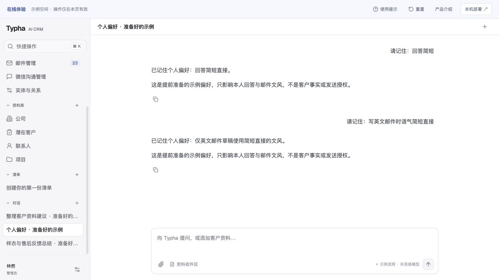](site/assets/agent-dialogue.jpg) | [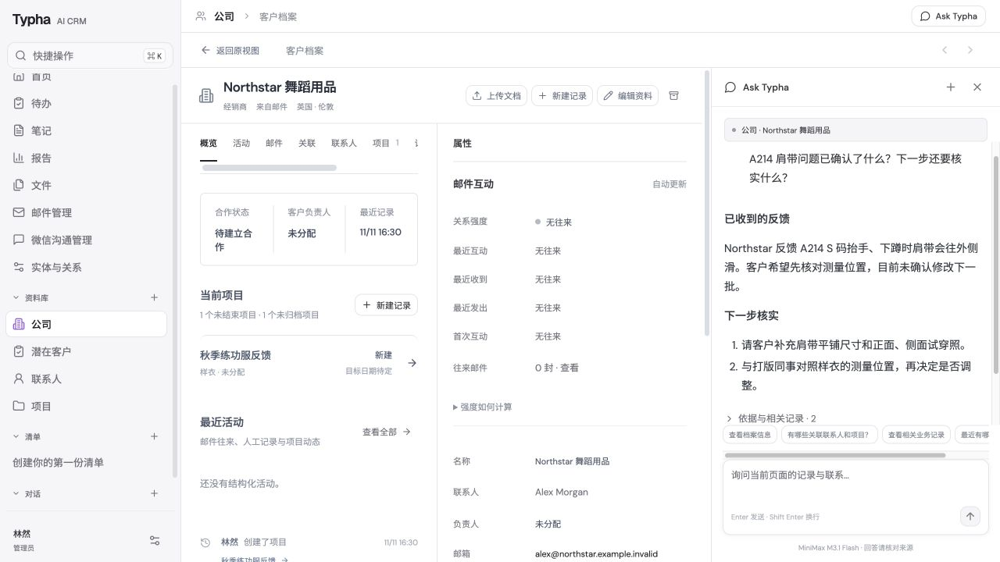](site/assets/ask-typha.jpg) |
| 在对话中补充偏好的适用范围，后续英文邮件草稿沿用已保存的文风。                           | 围绕当前客户提问，回看回答引用的资料。                                        |

| 邮件草稿与发送确认                                                                  | 活动待办                                                              |
| ----------------------------------------------------------------------------------- | --------------------------------------------------------------------- |
| [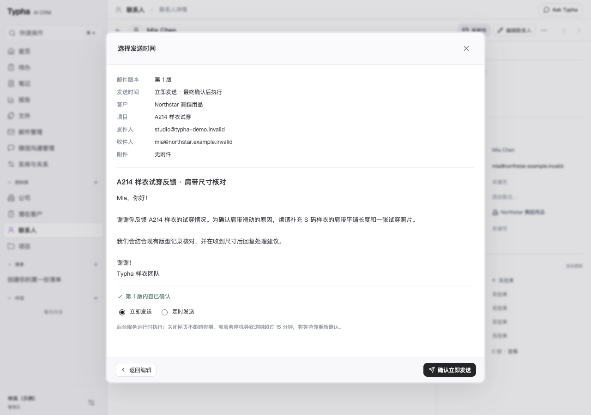](site/assets/mail-compose.png) | [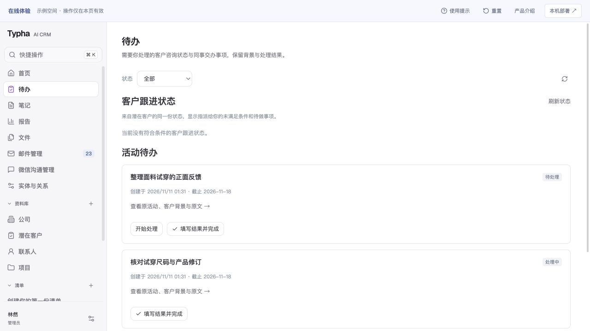](site/assets/team-todos.jpg) |
| 核对收件人和正文，选择立即发送或定时发送。                                          | 查看指派给自己的事项，回看原活动并记录处理结果。                      |

| 沟通总结与依据                                                                    | 客户资料整理建议                                                                  |
| --------------------------------------------------------------------------------- | --------------------------------------------------------------------------------- |
| [](site/assets/agent-summary.png) | [](site/assets/agent-update.png) |
| 明确客户、资料范围与待确认事项，引用信息可回到原文。                              | 对照已有字段与修改建议，核对后再保存业务资料。                                    |

| 记忆偏好                                                                  | 客户知识图谱                                                                |
| ------------------------------------------------------------------------- | --------------------------------------------------------------------------- |
| [](site/assets/agent-memory.png) | [](site/assets/agent-graph.png) |
| 明确保存个人沟通习惯，查看来源并自行管理。                                | 浏览实体、候选主张与关系，沿来源核对业务原话。                              |

## 技术架构

浏览器访问本机的 Node.js 服务。业务 API、Agent 执行和后台 worker 在同一服务中运行，业务数据默认保存在本机；知识检索通过可选的 Python 组件接入，生成与理解任务调用外部模型 API。

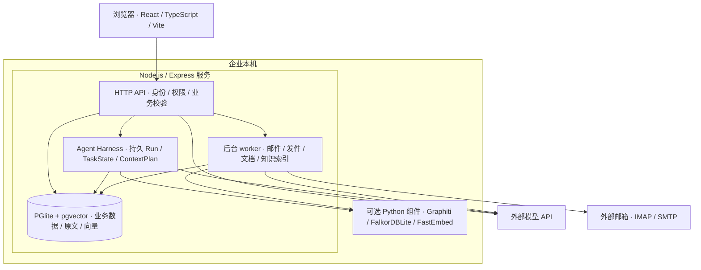

| 模块         | 实现与职责                                                                                    |
| ------------ | --------------------------------------------------------------------------------------------- |
| 界面         | React、TypeScript、Vite；提供资料库、对话、邮件、活动与报告页面。                             |
| 业务 API     | Express、Zod；校验输入、客户与项目归属，事务内设置访问身份，并通过 SQL RLS 限制数据范围。     |
| Agent 执行   | 持久 Run 管理任务生命周期，TaskState 保留条件，ContextPlan 组织上下文，Harness 校验工具结果。 |
| 业务与向量库 | PGlite 保存业务资料、上传原件、原文与任务状态；pgvector 保存原文切片向量。                    |
| 知识检索     | Python 桥接 Graphiti 与本机 FalkorDBLite；FastEmbed / MiniLM 在本机生成384维向量。            |
| 后台任务     | 同一 Node.js 服务内运行收信、已确认邮件发送、文档处理与索引任务；各自沿用对应配置和状态。     |

模型名称和接入方式按当前实现与配置说明区分；通用模型适配及企业自有 API 配置入口仍在完善。Graphiti 的 Python 依赖和嵌入模型需要另行准备，当前本机知识组件的验证以 macOS 为主。界面正文还引用 Google Fonts 的 DM Sans／Noto Sans SC；标题字体随包提供，在线体验使用随包字体与系统回退字体。详细设计见[技术架构](docs/architecture.md)与[知识组件配置](docs/knowledge.md)。

## 项目结构

以下是主要源码入口，便于从界面追到业务和执行逻辑：

```text
light_crm/
├── src/                         # React 页面、组件与界面状态
├── server/
│   ├── index.ts                 # 开发服务入口：数据库、worker、HTTP 与前端
│   ├── app.ts                   # HTTP 路由与能力接入
│   ├── db.ts                    # PGlite / PostgreSQL 适配与迁移
│   ├── security.ts              # 身份、事务范围与权限入口
│   ├── chats.ts                 # 首页对话与客户资料查询
│   ├── agent-*.ts               # 执行、状态、上下文、Skill 与工具合同
│   ├── skills/                  # 随版本发布的业务处理方法
│   └── migrations/              # 数据库迁移
├── shared/                      # 前后端共用类型与合同
├── scripts/graphiti/            # Python 图索引与本机嵌入桥接
├── tests/                       # 工程回归与隔离接口测试
├── evals/light-crm-v1/           # 工程测试使用的虚构数据
├── docs/                        # 架构、运行、知识与测试说明
└── .env.example                 # 当前实现使用的配置项
```

此公开预览包包含客户跟进、持久任务、邮件与售后报告等已验证的功能，未包含尚未发布的Commerce／Shopify与邮件自动待办。首次运行见[本机运行说明](docs/getting-started.md)。

## 账号、权限与存储

团队成员用各自的邮箱和密码登录，系统按账号进入客户工作台或协作待办。管理员在「设置 → 成员与权限」按客户授予只读或编辑权限，另行授予邮箱发信权。负责人字段用于分工。

| 账号           | 能看什么                                     | 能做什么                                                                     |
| -------------- | -------------------------------------------- | ---------------------------------------------------------------------------- |
| 老板（管理员） | 工作空间内的全部客户、成员与授权             | 管理团队账号，设置客户和邮箱发信权限                                         |
| 外贸业务员     | 获授权的客户资料、分给自己的待办             | 在有编辑权的客户下更新资料、发起交接。另获邮箱发信权后，可核对并发送附件邮件 |
| 国内业务员     | 获授权的客户资料、分给自己的待办             | 在有编辑权的客户下更新资料、发起交接。另获邮箱发信权后，可核对并发送附件邮件 |
| 设计师         | 自己收到的交接要求、截止日期、状态与提交结果 | 开始任务，上传尺码表并提交结果                                               |

业务员发起交接时只向协作人共享交办要求。尺码表交付后，业务员从原活动打开邮件草稿，系统带入附件及仍有客户访问权的默认抄送人。业务员核对后确认发送。

在线体验可直接选择四个虚构角色。以下演示图使用虚构资料，点击可查看大图。 [打开在线体验](https://tomanojerry-debug.github.io/typha-crm/)

| 在线角色入口                                                              | 成员与权限                                                                          | 设计师的协作待办                                                                    |
| ------------------------------------------------------------------------- | ----------------------------------------------------------------------------------- | ----------------------------------------------------------------------------------- |
| [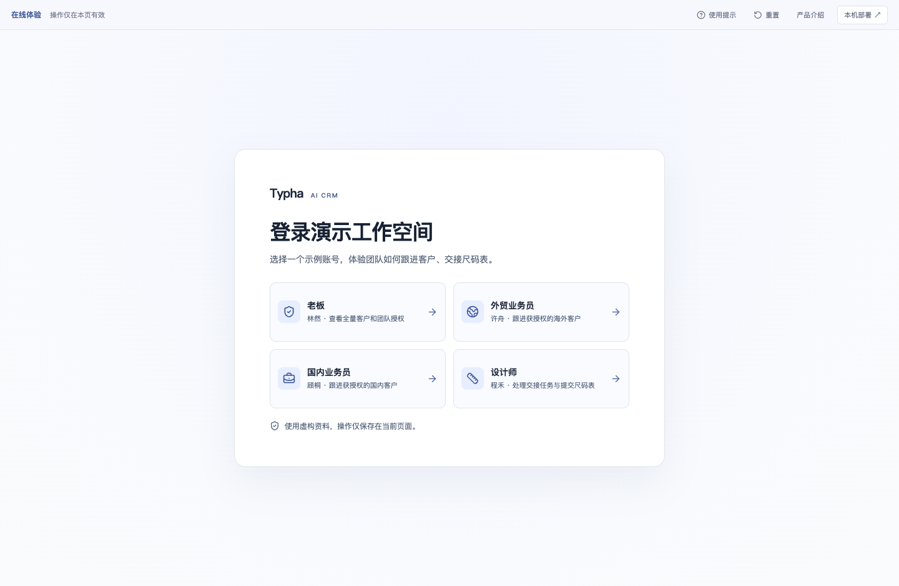](site/assets/team-login.png) | [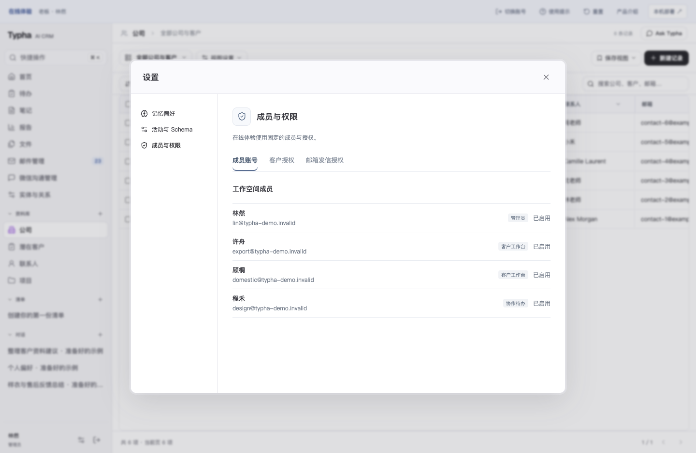](site/assets/team-permissions.png) | [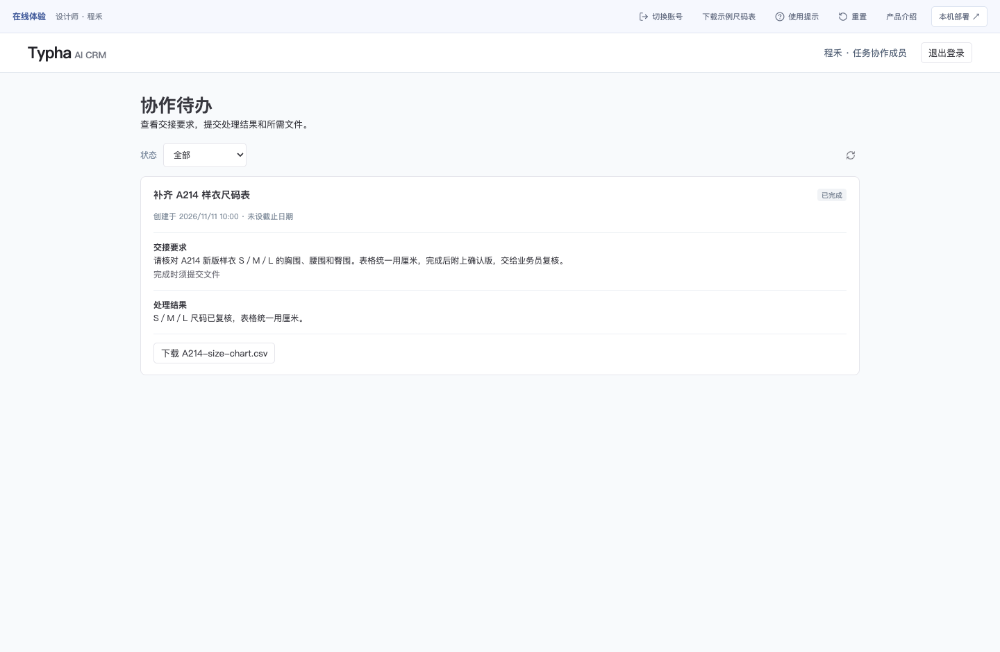](site/assets/designer-task.png) |

| 数据                   | 默认保存位置与用途                                                                                      |
| ---------------------- | ------------------------------------------------------------------------------------------------------- |
| 业务资料与上传原件     | `DATA_DIR` 指向的 PGlite 目录，默认 `.local/postgres`；包含客户、邮件、文档原件、笔记、活动及任务状态。 |
| 原文切片向量           | 同一数据库的 pgvector 表，用于按问题检索授权原文。                                                      |
| 图索引与本机模型文件   | `GRAPHITI_DATA_DIR`，默认 `.local/graphiti`；由 Python 组件维护派生索引与本机模型缓存。                 |
| 系统配置与邮箱加密密钥 | `.env` 与本机 `.local/mail-encryption.key`，或部署环境中的密钥配置；恢复邮箱连接时须与业务库一并保留。  |

默认 PGlite 为内嵌数据库，无需另启 PostgreSQL 服务。独立 PostgreSQL 已有适配代码，生产部署仍需另行验收。Graphiti 索引可以从有效业务资料重建，备份仍需包含原业务库及必要配置。

## Agent Harness

Harness是模型周围的执行与控制层：组织当前任务和证据，调用受限工具，管理运行、校验结果并保留评测依据。模型负责理解和生成，服务端负责权限、状态与执行；业务修改和发送继续遵守各自的用户确认流程。

当前邮件业务 Skill 的方法写在 `server/skills/handle-incoming-mail/SKILL.md`，由 `server/agent-skills.ts` 显式注册；执行步骤与工具合同由 Harness 控制。新增 Skill 需要注册、适配器测试和版本发布，权限、幂等与发送确认仍由业务服务保证。

### 一次任务如何执行

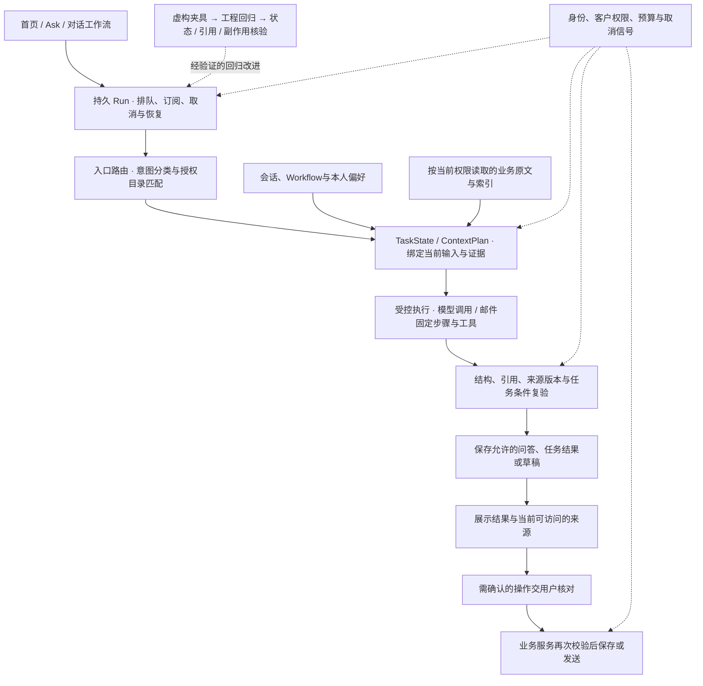

首页新消息先分类，再按权限检索并生成回答；Ask与工作流沿各自的页面和任务范围执行。问答成对提交，草稿保存与发送确认分开，切页仅退订展示，明确停止才取消运行。

### 四部分的当前实现

| 部分             | 已有能力                                                                                                                                     | 当前边界                                                                                                          |
| ---------------- | -------------------------------------------------------------------------------------------------------------------------------------------- | ----------------------------------------------------------------------------------------------------------------- |
| 上下文与记忆     | Session保留完整日志；TaskState表达任务条件；ContextPlan绑定本轮输入、历史、偏好、证据和容量摘要，模型前与提交前复验。                        | ContextPlan覆盖首页分类／回答、Ask、对话工作流和单文件问答；AI属性、文档填空、活动等独立适配器仍待统一接入。      |
| 工具与执行流程   | 邮件采用固定步骤、受控Skill和核心输入输出合同，区分读取、草稿写入与取消；稳定操作ID保证草稿幂等，用户确认后由业务服务发送。                  | 动态工具目录尚未完整统一；已有模板变量纠正最多一次，不能扩大成任意工具循环或通用结构纠正。                        |
| 运行、安全与隐私 | 主要持久对话Run共用默认180秒／8次模型调用，取消传到原生请求／读取器；记录可获得的实际usage，持续复验workspace、actor、客户／项目归属及来源。 | 预算尚未覆盖所有独立入口；完整费用预算、全运行版本清单、分布式调度和任意节点续跑仍待补。未知usage与费用保持未知。 |
| 评测与反馈       | 固定虚构夹具与可注入transport验证动作、状态、来源和副作用；工程回归覆盖权限、取消、幂等、恢复及统计。                                        | 本包提供工程测试和有限夹具，完整90项产品场景、裁判工具与正式人工校准另行整理；工程通过不等于业务准确率。          |

### 有界恢复与停止

| 情况                                                       | 当前处理                                                                                                                                                     |
| ---------------------------------------------------------- | ------------------------------------------------------------------------------------------------------------------------------------------------------------ |
| 持久首页／Ask／工作流回答遇到明确的瞬时模型故障            | 有有效ContextPlan、当前领域复验且尚未展示正文时，整次Run最多重试一次；复用同一输入和原180秒／8调用预算。                                                     |
| 缺少业务条件或需要用户口径                                 | 等待补充，保留仍有效的任务条件，不擅自填造事实。                                                                                                             |
| 其他输出结构／引用错误，或鉴权、额度、取消、超时、预算问题 | 明确失败或停止；已有邮件模板变量的单次纠正继续受原合同约束。                                                                                                 |
| 首页对话中，已知旧任务资料当前无法访问或引用               | 服务端以系统状态保存并显示停止结果（`model:null`），阻止旧正文与模型原始流式内容继续显示；开始其他无目标任务可新建对话。模型调用、解析或复验失败仍返回错误。 |
| 业务写入、发送或发送结果不确定                             | 不进入模型故障自动重试；发送不确定时先核对真实状态，避免重复发送。                                                                                           |

离页、刷新和服务重启分别处理：已提交结果可恢复，未执行的排队任务可恢复；重启时未完成的运行标记中断并等待用户重试。业务反馈与失败样例用于继续完善回归。

工程回归、真实模型试跑与业务语义验收分别记录。当前公开包不包含内部发布记录、真实通信、实际模型试跑材料或完整裁判工具链。详见[Harness设计](docs/architecture.md)与[测试范围](docs/evaluation.md)。

## 记忆架构

Typha将对话、任务、个人习惯和客户知识分层保存，让Agent既能接着处理当前工作，也能找回有出处的业务资料。

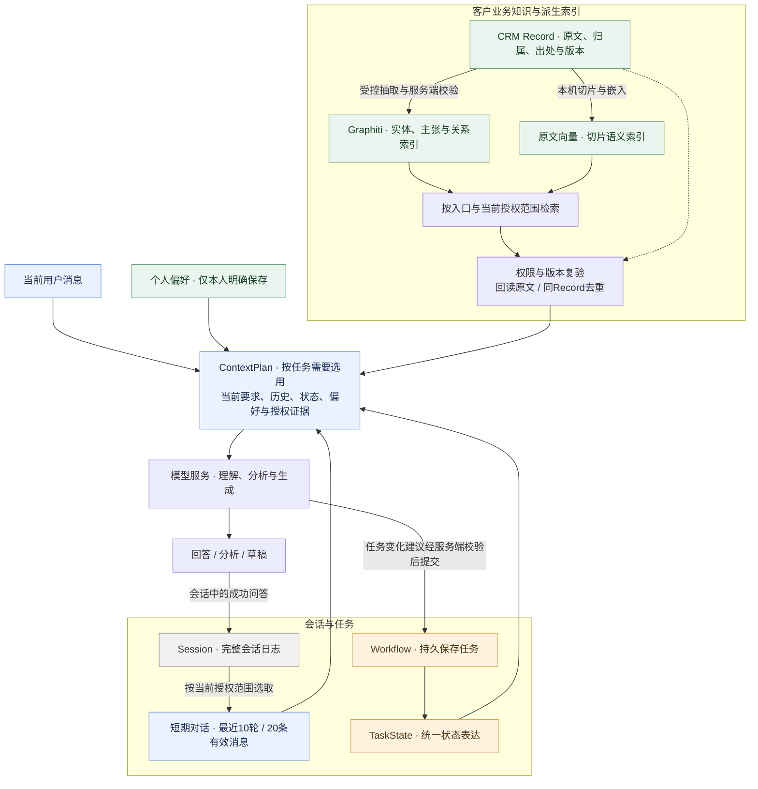

图展示组件关系：蓝色为本轮使用的上下文，橙色为任务状态，绿色为长期偏好、业务资料及派生索引，灰色为完整日志。主要对话与单文件问答已接入ContextPlan；各入口按自身范围选择历史、偏好与检索渠道。

| 层次     | 保存什么、如何使用                                                                                                  |
| -------- | ------------------------------------------------------------------------------------------------------------------- |
| 短期对话 | 当前授权范围内最近10轮／20条消息用于承接对话；完整会话日志另行保留。                                                |
| 跨轮任务 | Workflow持久保存任务对象、阶段、条件、模板和结果引用，TaskState统一表达这些状态；修改条件后复验，取消后停止旧任务。 |
| 个人偏好 | 仅在本人明确要求或在设置中保存时记住，可编辑、删除；按用户隔离，不代替业务授权。                                    |
| 业务原文 | CRM Record保留资料、业务归属与出处，区分客户原话、内部推断和公司确认。                                              |
| 知识图谱 | Graphiti从业务资料派生实体、主张和关系索引，帮助查找关联信息。                                                      |
| 原文向量 | 本机多语言嵌入帮助按含义找回原文切片，与图谱共享Record来源。                                                        |

检索命中后回读当前授权原文，同一Record合并为一份证据；各入口按已接入的范围选择索引。ContextPlan绑定本轮选用的历史、任务条件、偏好与业务资料，在模型调用前和结果提交前复验范围与版本。

完整日志不会自动全部送入模型，对话内容也不会自动成为长期偏好或已确认业务事实。详细分层、检索与失效机制见[记忆架构](docs/memory.md)。

## 开发与验证

### 配置

开发环境要求 Node.js 22.13 或更新版本。配置名称以 [.env.example](.env.example) 为准，常用项如下；示例文件不包含可用密钥。

| 配置项                                                         | 用途                                                                         |
| -------------------------------------------------------------- | ---------------------------------------------------------------------------- |
| `HOST`、`PORT`、`APP_ORIGIN`                                   | 服务监听与访问地址，默认 `127.0.0.1:3100`。                                  |
| `DATA_DIR`                                                     | 本机 PGlite 数据目录；同一目录由唯一进程使用。                               |
| `MINIMAX_API_KEY`、`MINIMAX_API_REGION`、`MINIMAX_CN_ENDPOINT` | 当前模型适配器的服务端密钥、区域与固定端点选择；通用自定义模型接口仍在完善。 |
| `GRAPHITI_ENABLED`、`GRAPHITI_PYTHON`、`GRAPHITI_DATA_DIR`     | 启用和定位本机知识组件，具体准备步骤见知识组件文档。                         |
| `LOCAL_ACCESS_EMAIL`                                           | 本机直接进入已有账号，仅适用于回环地址、开发模式与本地 PGlite。              |
| `MAIL_ENCRYPTION_KEY`                                          | 部署环境使用的邮箱授权码加密密钥；本机开发可由系统生成密钥文件。             |
| `WECHAT_CLI_BIN`、`WECHAT_CLI_CONFIG`                          | 实验性微信读取器与其本机配置，需先完成对应客户端环境准备。                   |

模型密钥由服务端读取，当前没有面向普通用户的任意模型切换界面。`GRAPHITI_ENABLED` 只控制知识组件，收信、发送等 worker 继续按各自配置运行。

### 代码检查

安装依赖后可运行代码检查和测试：

```bash
npm ci
npm run typecheck
npm test
npm run build
```

首次安装、虚构示例与启动步骤见[本机运行](docs/getting-started.md)。`setup` 用于初始化新环境；`npm start` 进入生产模式并要求 HTTPS 配置。GitHub Pages 发布浏览器内的产品体验，完整CRM运行在企业自己的环境。

工程回归、真实模型试跑和业务语义评测分别记录，见[产品评测说明](docs/evaluation.md)。

## 项目状态与参与

当前已支持潜在客户跟进和售后反馈报告，重点继续完善安装体验、团队管理、模型适配、其余Agent入口的公共执行合同，以及完整业务评测与人工校准。微信读取仍属实验性能力；Commerce／Shopify属于独立开发内容，尚未进入当前日常发布版本。

欢迎参与虚构业务场景、资料检索、任务交互、连接器适配、界面本地化和文档改进。

## 许可证

项目代码采用 [MIT](LICENSE)。第三方字体与组件保留各自的许可和版权声明，详见 [NOTICE](NOTICE)。在线体验使用与真实业务隔离的示例数据，项目不包含企业真实资料或访问凭据。
